# Depot

**A downloads section for Flarum 2.** Files with versions and changelogs, a published checksum for every release, ratings and reviews, a support discussion for each file, approval for members' uploads, and categories you can lock to a group. Built from Flarum's own components, so it looks like the rest of your forum on any theme.

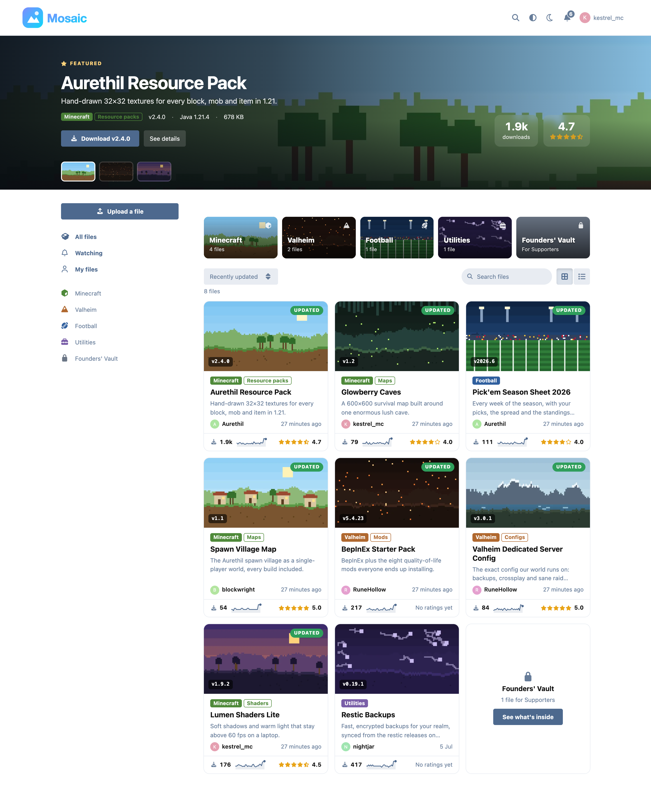

## What it does

**Browse**
- A featured spotlight across the top, one file at a time, with its download button right there.
- Category tiles, then every file as cards or a list (the choice is remembered).
- Sort by recently updated, most downloaded, top rated or newest. Inside a category, filter by the version a file works with. Search by name or summary.
- Each file shows its version, who made it, how recently it changed, its downloads with a 30-day trend line, and its rating.
- Watching and My files views for members, and an approval queue for moderators.

**A file's page**
- Screenshots with a full-size viewer (arrow keys move between them).
- At a glance: what it works with, extra details, licence, what else you need, and numbered install steps.
- What's new in this version, grouped into Added, Changed and Fixed.
- Every version on a timeline, each with its own changelog, size, download count, checksum and download button. Older versions are also in the download button's menu.
- Reviews: one per member, a rating breakdown you can filter by, the author's reply under a review, and helpful votes.
- The support discussion's latest posts, read through Flarum's own API.

**Downloading**
- After the click, a sheet shows how to check the file is the one the author published: the command for macOS, Windows or Linux (detected) and the SHA-256 it should print, both with copy buttons. Then the install steps, and a button to watch for the next version.
- Each download is counted once per member, or per address for guests, inside a window you choose. Addresses are never stored, only a keyed hash for as long as the window lasts.

**Uploading**, in five short steps:
1. **File:** upload it, link to where it's hosted, or point at a public GitHub repository so every release appears automatically. An uploaded file's SHA-256 is worked out in the browser as soon as it's dropped, and again by the server, which is the one kept.
2. **Details:** name, category, version, what it works with, summary, description, licence, install steps and requirements.
3. **Screenshots:** up to eight. The first is the cover.
4. **Support:** start a support discussion for the file and pick which of the forum's tags it goes in, with a preview of how it will look in the discussion list.
5. **Review:** check it over and submit. Members' files wait for a moderator; the uploader gets a notification when it's approved, and the support discussion starts then.

**For admins**
- Categories, two levels deep, ordered by drag and drop. Lock one to groups and others see that it exists, with a count, but none of its files.
- Permissions in Flarum's own Permissions page: view, download, upload, upload without approval, rate and review, moderate.
- Settings for the download-count window, the largest upload, uploads per member per hour, support discussions, GitHub sync, an optional GitHub token, and an optional nginx internal location.

**For developers**
- `GET /api/depot/latest/{slug}` answers with the latest version, its checksum, size and download URL, so mods and launchers can check for updates without loading a page.

## Screenshots

| | |
|---|---|
| 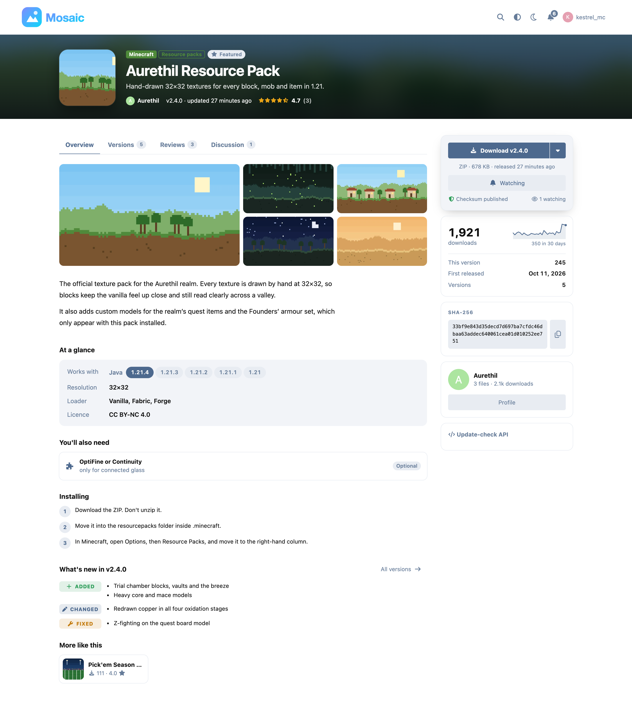 | 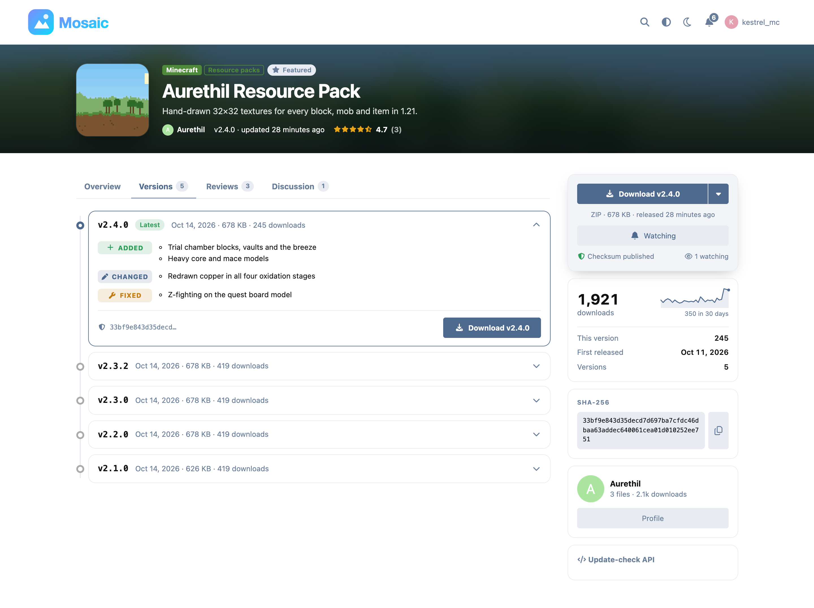 |
| A file's page | Every version, with its changelog |
| 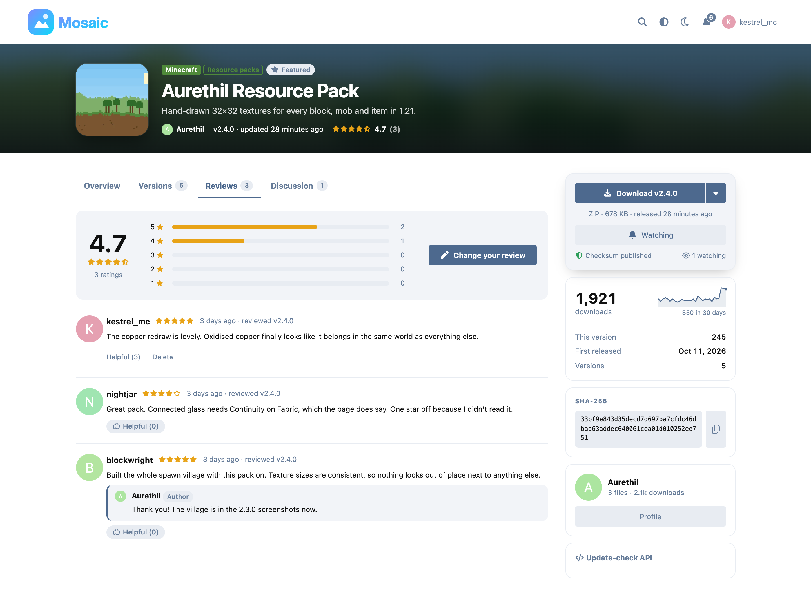 | 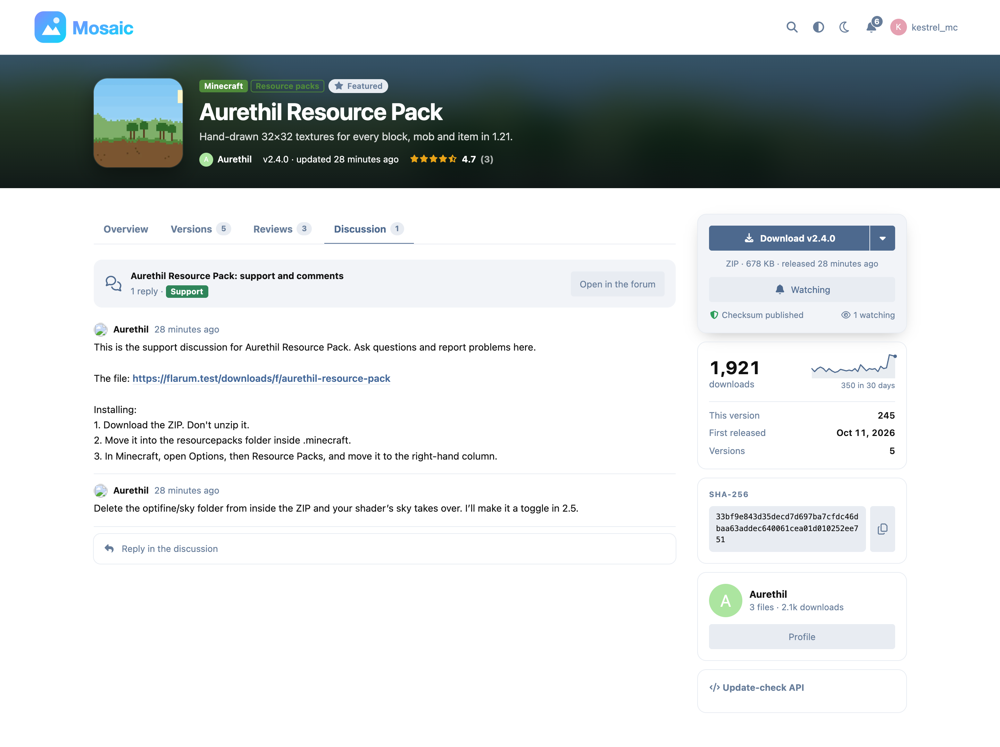 |
| Reviews | The support discussion |
| 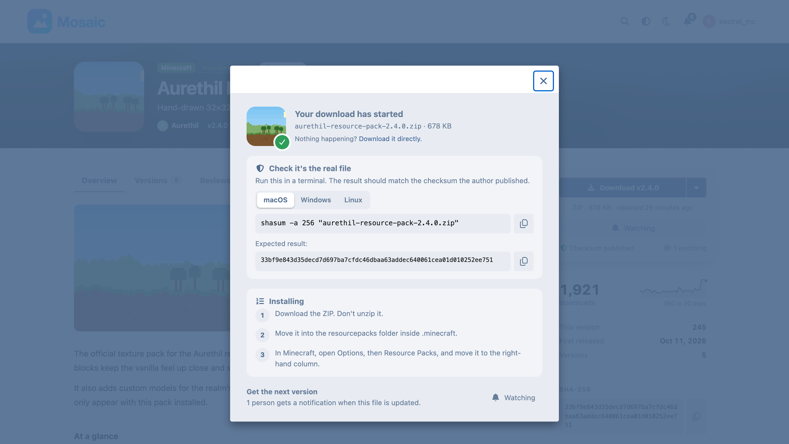 | 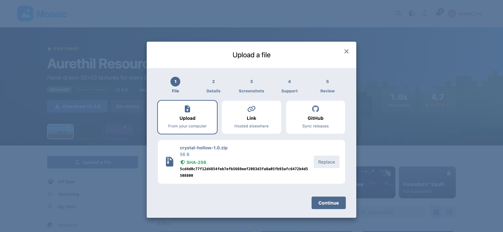 |
| After the download starts | Upload: the checksum is worked out on drop |
| 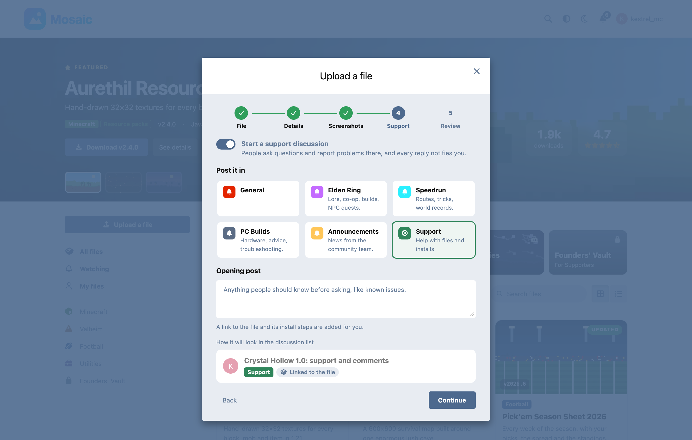 | 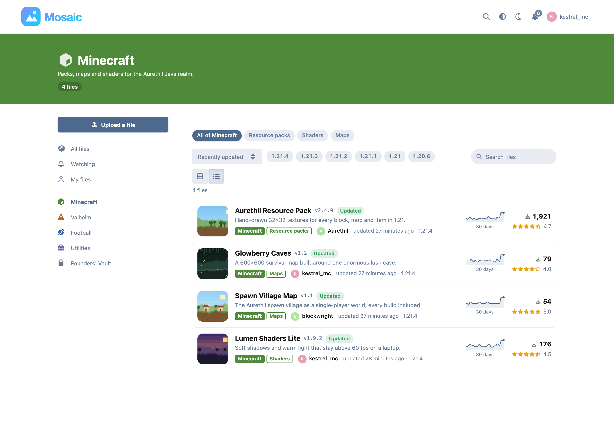 |
| Upload: pick the tag for the support discussion | A category, as a list |
| 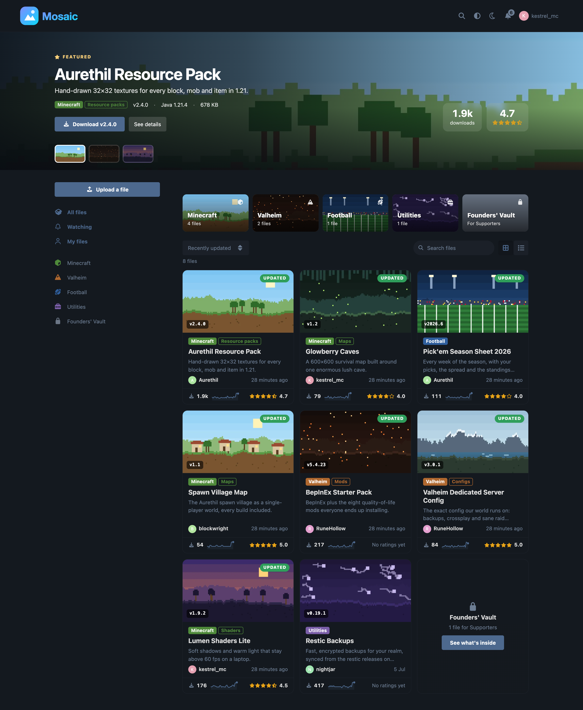 | 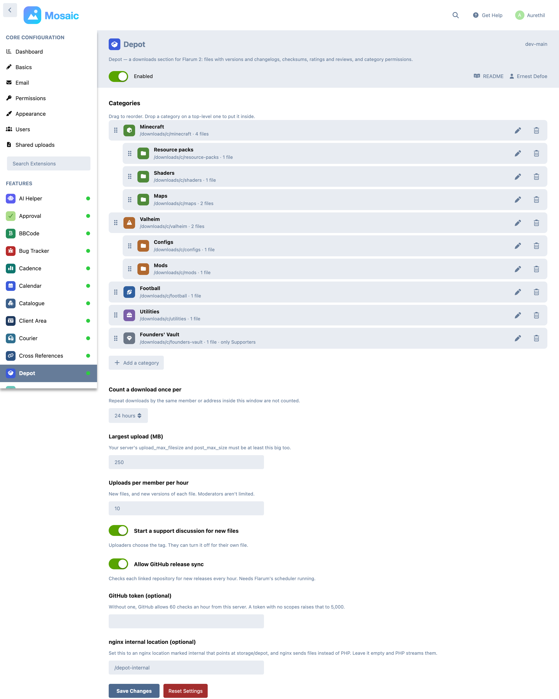 |
| Dark scheme | Categories and settings |

<p>
  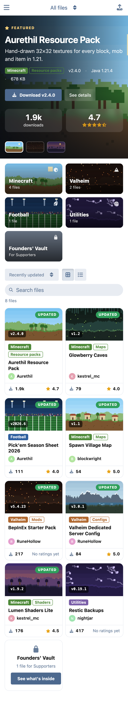
  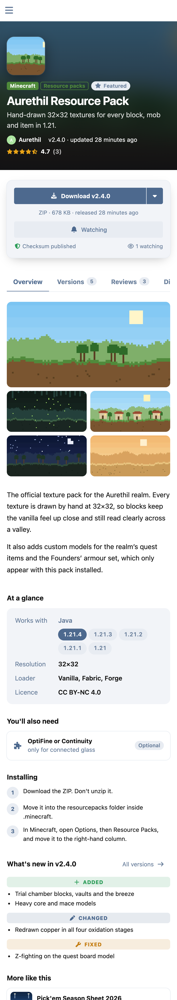
</p>

## Install

```bash
composer require ernestdefoe/depot
php flarum migrate
php flarum cache:clear
```

Enable it in the admin panel, add a category or two on its settings page, and **Downloads** appears in the forum's sidebar.

Requires PHP 8.3 with GD, and Flarum 2. flarum/tags is optional: with it, uploaders choose the tag for each file's support discussion.

**Large files:** Depot accepts what its setting allows, but PHP's `upload_max_filesize` and `post_max_size` must be at least as large.

**GitHub sync** runs hourly through Flarum's scheduler, so the scheduler must be running (`* * * * * php flarum schedule:run`).

**nginx (optional):** to have nginx send files instead of PHP, add an internal location pointing at Depot's private storage and enter its path in the settings:

```nginx
location /depot-internal/ {
    internal;
    alias /path/to/flarum/storage/depot/;
}
```

## Updating

```bash
composer update ernestdefoe/depot
php flarum migrate
php flarum cache:clear
```

## Built on Flarum, not beside it

- The browse page is Flarum's `PageStructure` with a subclass of core's `IndexSidebar`, so the sidebar, the mobile drop-down and the spacing are core's own, and a theme that styles the discussion list styles Depot too.
- Modals are Flarum's `Modal` and `FormModal`; the download button is core's `SplitDropdown`; dates, avatars and alerts are core's.
- Every colour is a Flarum variable, so Depot follows the forum's theme and its light and dark schemes with no settings of its own.
- **Light on every other page:** the bundle every forum page carries is 2.7 KB gzipped (routes, one sidebar link, notifications). The pages and their stylesheet load only when someone opens Downloads, so forum.css carries none of Depot.
- Lists cost a fixed number of queries whatever their length: browse is 6, a file's page 14 for a guest.

## Security

- Files are stored on a private disk under the SHA-256 of their bytes, and served only through a route that checks permission, as `application/octet-stream` attachments under a sandbox policy. An uploaded HTML or SVG file can never run on your forum.
- Screenshots are decoded and drawn again as WebP, which strips EXIF (including GPS) and anything riding along in the file. Pictures claiming more than 40 megapixels are refused before decoding.
- Every list and page goes through one visibility rule: approved files outside locked categories, plus your own files, plus everything for moderators.
- Members' uploads are limited per hour. With a GitHub token set, private repositories are refused, so a member can't use the forum's token to read one.

## Development

```bash
cd js && npm install && npm run build
composer install && composer test:setup && composer test
```

`tools/seed-demo.mjs` fills a local forum with demo content through the real API and checks every step on the way (uploads, approval, support discussions, versions, notifications, reviews, downloads and checksums). `tools/shots.mjs` takes the screenshots above on Flarum's default theme. Both sign in with remember tokens minted on the server, never a typed password.

## Licence

MIT. See [LICENSE](LICENSE).

☕ If you like the things I have built, consider [buying me a coffee](https://buymeacoffee.com/ernestdefoe).
